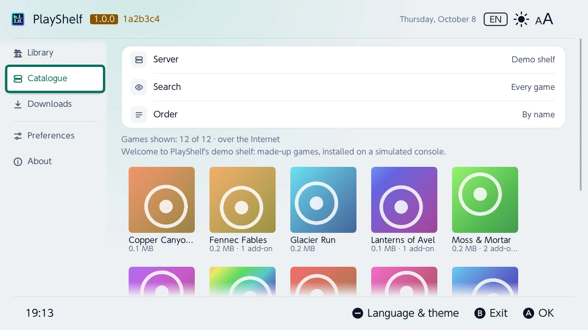
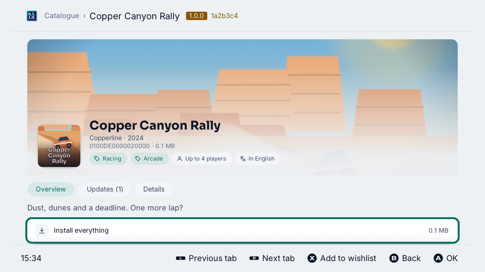
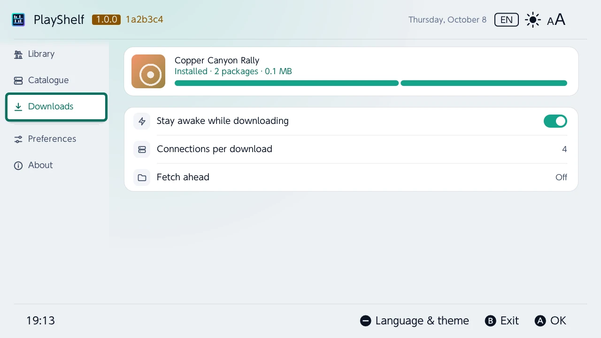
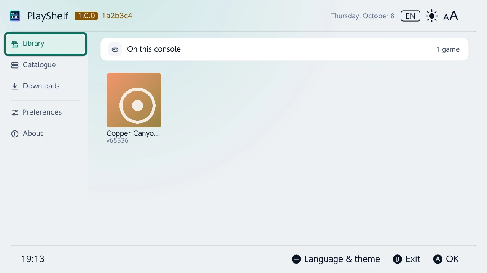
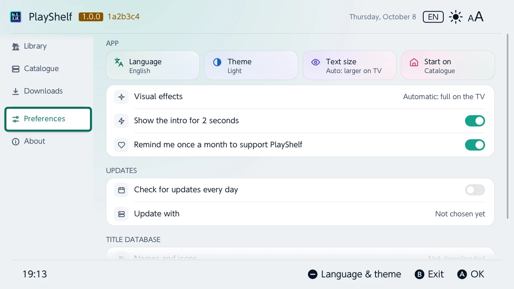

# Getting started

PlayShelf browses a library server you run yourself and installs your own backups and homebrew from it: a game's base, its updates and its add-ons, as NSP, NSZ, XCI or XCZ, over HTTPS. This page goes from the SD card to a first game installed.

> [!WARNING]
> **Early development.** No release is published yet. The [web simulator](https://shelf.boreale.dev/simulator/?utm_source=github&utm_medium=docs) shows where PlayShelf stands, against a demo server of made-up games.

## What you need

- A Nintendo Switch with [Atmosphère](https://github.com/Atmosphere-NX/Atmosphere).
- [sys-patch](https://github.com/impeeza/sys-patch) or sigpatches, for the games installed to start. PlayShelf looks for them before it installs, and asks whether to go on when it finds neither.
- A library server of your own, reachable over HTTPS: [AeroFoil](https://github.com/luketanti/AeroFoil), Ownfoil, or any web server with a JSON index of your files. See [Library servers](servers.md).

## Install PlayShelf

1. Download `playshelf.zip` from the [latest release](https://github.com/JigSawFr/PlayShelf/releases).
2. Extract it to the root of the SD card: it puts `switch/playshelf/playshelf.nro` in place.
3. Start PlayShelf from the homebrew menu. Started over a game (hold R while starting one), it has the console's full memory; from the album it runs as an applet, with less.

PlayShelf keeps its settings and its data in `sd:/config/playshelf/`: its servers, its downloads, its title database and its reports.

## Add your server

The first start opens on **Home**, which welcomes you: there is no server yet.

- **Add a server**: its name, its `https://` address on your network, over the Internet or both, and its user name and password if it has an account. See [Adding a server](servers.md#adding-a-server).
- **Find on this network**: lists the AeroFoil and Ownfoil servers that answer on the console's network, to pick one.

## Install a game

**Home**, at the top of the rail, says where the console and its servers stand. At the top, **Search** looks for a game by its name (or its publisher) on every server at once, then among the console's games no server has. Tiles count the console's games, the updates and add-ons the servers have that it has not (Ⓐ on the updates: **Update all**, the most played games first, or the list), the downloads under way and the room left on the SD card (Ⓐ: **Storage**, below). Then rows: **Played lately** (the console's games by when they were last played, with their play time), the games with something to get (the most played first) as wide banners, **For you** and **In your series** (below), **Your wishlist** (Ⓧ on a game's page adds it or takes it away; those a server has come first), **New on your servers** (the games a server has had for less than a month, from the second time PlayShelf reads it), **Popular on your servers** and **Trending** (below), the month's releases (else the servers' newest games) and **Coming soon** (the next two months' games the title databases date; Ⓐ puts one on the wishlist). The play time is the console's own (every account together), read as PlayGuard reads it. Every server's catalogue is read once PlayShelf starts, one after the other; the rail's Home counts the console's games with something to get. PlayShelf opens on Home; *Preferences › Start on* picks another tab.

**Popular** and **Trending** come from Wikipedia: how many Wikipedias have a page on each game and how many critics reviewed it (Wikidata), and how often its English page was read last month against the two before. [Atlas](https://github.com/JigSawFr/Atlas) makes that list again every week, with each game's critics' score, which its page's **Details** show. PlayShelf comes with it and fetches the newest one once a day, only the files that changed (*Preferences › Title database › Popular games from Wikipedia*, [`popular_online`](config.md)); only the games of your servers show.

**For you** weighs many signals at once and says, under each cover, the one that weighed most: games like the ones the console plays (*Like …*, or *35 h of …* for a game played 10 hours or more: Atlas compares every game's series, developers, publishers, genres and modes from Wikidata), the more a game was played and the more lately, the more it counts; games of the same series (*Series: …*) or developer (*By …*); the genres of the console's games; how well known a game is, what critics gave it and, for one also on Steam, how its players rate it (*Popular*); and a little more for one out this year. The row is varied: each game in it counts against the next ones of its series, by its developer or much like it, so one series does not fill it. Ⓧ on a suggestion says you are not interested: it is no longer suggested, and the games much like it less often (*Preferences › Games not to suggest* suggests them all again). Ⓧ does the same on the covers of In your series, Deals, New on your servers and Trending, and on the banners of Popular on your servers; a game put away leaves those rows too. **In your series** lists the servers' other games of the series the console has games of. A game's page shows its **Other editions** the servers have (a Deluxe, Complete or GOTY edition, or the game itself from one of them), the games most like it the servers have (**Similar games**), and its **Details** its series, its Steam reviews and, once 20 players have rated it on IGDB, their **Players' rating**. A game and its editions count as one: none of them is suggested when the console has one, and a row shows one cover for them, the game's when the row has it. **Deals** lists the servers' games on sale on the eShop, the biggest discount first, each with its discount and its sale price (*-30 % · 13,99 €*); a game's **Details** give its **eShop price**, and on sale its regular price, its sale price and the sale's last day, *lowest price yet* when it is, and the lowest it has had since Atlas began following prices when that was lower. A sale at its lowest price yet is amber, with a gem on its cover; on the other rows (In your series, New on your servers, Trending, the banners) a game on sale shows its discount and price instead of its usual line, and For you keeps its reason with a tag on the cover. The prices are those of your language's country unless *Preferences › Title database › eShop prices from* picks another, or none.

**Storage** shows the SD card's room as a bar (the games, the rest, what is free), then **To free**, the large games not played for three months, and every game by the room it takes, with when it was last played. Ⓐ on one: delete it (its saves stay) or open its page.

**The bell**, at the right of the header, counts what is to do; Ⓨ (from a tab without its own Ⓨ) or a tap opens the list. **To do**: the updates and add-ons to get, a game of the wishlist a server now has, the SD card nearly full (under a tenth or 4 GB free), a download that failed; Ⓐ does it or opens where it is done. **For information**: a game of the wishlist on sale on the eShop (its discount, price and the sale's last day; *goes on sale* the day it starts, *lowest price* at its lowest; put away, it comes back with the next sale or a lower price), out today, or whose price fell to its lowest without a sale (from what Atlas' last daily run changed, until the next one), the games new on the servers, the updates the title databases know and no server has yet, the downloads installed, a new version of PlayShelf; Ⓧ puts one away (Ⓨ: all of them), until what it says changes.

**The other Boréale homebrews** (PlayGuard…) get a section each at the end of the list, under their name, with what they have to say; what is to do or failed there is counted on the bell too, read again every minute. Ⓐ on one starts that homebrew at the screen it names once PlayShelf closes (when PlayShelf was started from the homebrew menu; otherwise a message says to open it from there); nothing of the other homebrew runs in PlayShelf. *Preferences › The other Boréale homebrews' notifications* turns them off. In return, PlayShelf's own entries show in their bells, and opening one there starts PlayShelf on the tab where it is dealt with.

When the same package is on several servers read, the download comes from the best one: a server on the console's network first, then the one earlier downloads ran fastest from.

The **Catalogue** shows the server's games as covers, with their size and their add-ons, and a mark on the cover of a game the console has (in amber when there is an update to get). Its controls are a row of pills above them: the server, the search, the order, the filters and the section, in teal while they narrow the list. **Search** and **Order** (by name, newest, largest, publisher, or by genre as shelves: a row of covers a genre, the games not known yet on the last one, **See all** at the end of a full one for the whole genre) narrow it; a server with sections shows them too. **Filters** keep the games of a genre, of a publisher, for one player or several, in your language, by what the console has of them (not there, there, an update or add-ons to get), demos hidden. Genres, publishers, players and languages come from Nlib API as the games show: while a filter needs them, the games not known yet are asked in the background and join the list as they come (the line under the filters says how many are known). The **Library** has its own pills: how many games (Ⓐ reads them again) and **Order and filters**: by name, publisher, newest, the games with something to get first (the most played of them first), the most played, or the ones played lately; its filters also keep the games never played.

| Catalogue | A game's page |
|---|---|
|  |  |

Press Ⓐ on a game for its page: **Install everything**, or its base game, one of its updates or one of its add-ons. Each one goes to the **Downloads**. The page has tabs (Ⓐ on one, or Ⓛ and Ⓡ): **Overview**, **Updates** (the version installed and the newest, the newest at once, each update), **Add-ons** (how many the console has, the missing ones at once, each add-on) and **Details** (its ids, sizes, publisher, developer, release date, genres, players, languages, age rating, and its eShop page as a QR code for a phone). When the console is online, it shows what [Nlib API](https://api.nlib.cc/nx/) knows of the game in PlayShelf's language: its banner across the top with the game's name over it, its publisher and year, its genres, players and whether it is in your language as chips, a summary, its screenshots (Ⓐ shows one on the whole screen, ◀ ▶ the others), its description, and more of the catalogue's games from its publisher and in its genre. Details also say how long the console played it, how many times it started it and when it last played it. **Available on** names the servers that have the game; Details says what each one has of it (the base game, how many updates and the newest, how many add-ons). The Library opens the same page for a game on the console.

## Follow the downloads

The **Downloads** install the packages one after the other, each with its progress, its speed and the time left. Ⓐ on a game or a package offers to pause it, resume it, try it again or remove it. Once installed, the game is in the **Library**. See [Downloads](downloads.md).

| Downloads | Library |
|---|---|
|  |  |

## Names and icons

A game that neither the console nor the server names takes its name and icon from the title database, kept on the SD card: *Preferences › Title database › Download*. Its sources are CyberFoil-DB, NXMeta and Ghostland by default, and you can add your own. See [`title_sources`](config.md).

An icon that none of them has is asked of [Nlib API](https://api.nlib.cc/nx/) over the Internet, for the games on screen only, then kept in the cache. Base games only: an update or an add-on shows its game's icon. *Preferences › Title database › Icons and game pages from Nlib API* turns it off ([`nlib_api`](config.md)).

## Preferences

*Preferences* sets the language (the console's, or one of 15), the theme and its palette (PlayShelf's, a preset or [your own](themes.md)), the text size, the tab PlayShelf starts on, the updates and the title database. Every setting is also in [`config.json`](config.md).

Back to the [README](../README.md).
